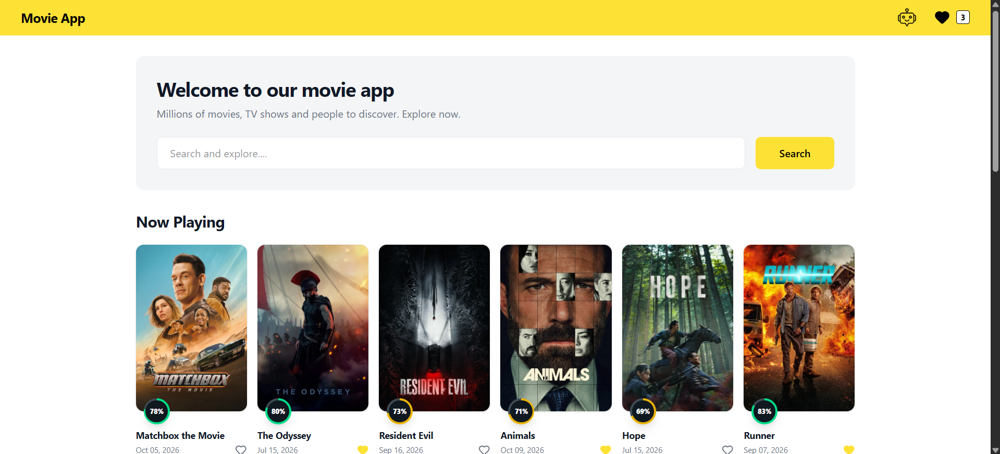
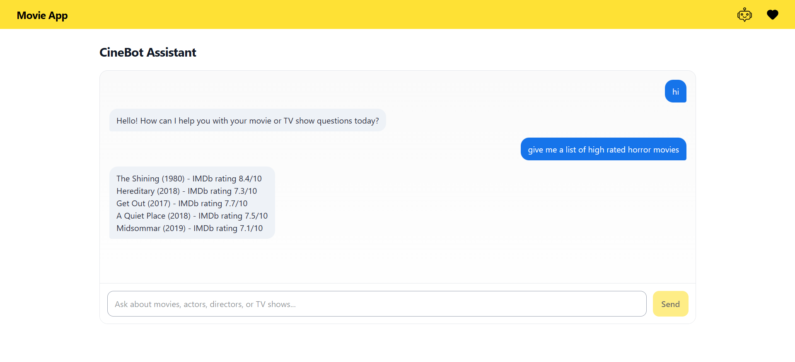
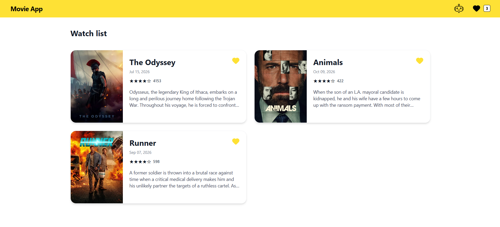
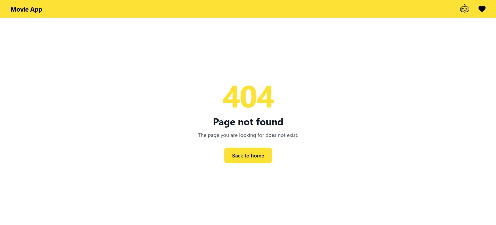

# Movie App

A movie discovery platform built with React 19 and Vite, powered by live TMDB data and CineBot — an AI movie assistant running on Groq. Browse now-playing titles, search the full TMDB catalog, explore details and recommendations, keep a persistent watchlist, and ask the assistant anything about cinema.

## Screenshots

| Home — now playing & search | CineBot — AI movie assistant |
| :---: | :---: |
|  |  |
| **Watchlist — saved movies** | **Not found — custom 404 page** |
|  |  |

## Design

The complete UI design is available on Figma: [View Design File](https://www.figma.com/design/jvGvsGLg6X3T7JPU3E2rNl/Movie-App?node-id=0-1&p=f)

## Features

- **Now Playing feed** — paginated grid of current theatrical releases with score badges and release dates.
- **Catalog search** — the query lives in the URL (`/search?query=...`), so results survive refreshes and can be shared.
- **Movie details** — overview, genres, runtime, spoken languages, production companies, star rating, and similar-title recommendations.
- **Watchlist** — add/remove from any poster card or details page; persisted in `localStorage`, shared app-wide via Context, with a live count in the header.
- **CineBot assistant** — conversational movie expert (Groq) that answers cinema-related questions only, keeps a bounded conversation history, and returns recommendations in a strict plain-text format.
- **Engineered AI behavior** — a server-managed system prompt matches answer length to the question and formats recommendations as plain text, one title per line; it returns up to five titles by default or up to ten when a number is requested, with years and ratings for top-rated requests.
- **Resilient UI states** — loading, error, empty, and not-found experiences provide clear feedback throughout the app.
- **Responsive design** — mobile-first layouts built with Tailwind CSS 4 and custom keyframe animations.

## Tech Stack

| Area | Technologies |
| --- | --- |
| UI | React 19, JSX, function components, React Compiler |
| State | Context API, `useState` / `useEffect` / `useRef`, `localStorage` |
| Routing | React Router 7 — `BrowserRouter`, `Routes`, `Route`, `Link`, `useParams`, `useSearchParams`, `useNavigate` |
| HTTP | Axios |
| Data & AI | TMDB API (movie data), Groq API (chat completions) |
| Styling | Tailwind CSS 4, custom CSS |
| Icons | Lucide React |
| Build | Vite 8 + React Compiler (Babel preset) |
| Server layer | Vercel serverless functions (API proxy + validation) |
| Quality | ESLint with `react-hooks` and `react-refresh` plugins |

## How It Works

- API keys live **only** in server-side environment variables — the browser bundle never sees them.
- The server layer validates resource names, movie IDs, page numbers, search queries, and chat payloads. It accepts user and assistant conversation messages with role-specific character limits and a bounded history; the system prompt is managed and added server-side.
- Chat failures are translated into friendly, status-specific messages (invalid request, rate limit, unreachable network) instead of raw API errors.
- A Vite dev proxy mirrors the production endpoints, so the frontend code is identical in development and deployment.

## Application Routes

| Route | Page |
| --- | --- |
| `/` | Now-playing movies and search |
| `/search?query=...` | Search results with pagination |
| `/movie/:id` | Movie details and recommendations |
| `/watchlist` | Saved movies |
| `/assistant` | CineBot chat |
| Any other path | Custom not-found page |

## What I Built and Practiced

**React & state management**
- Split the UI into reusable page and component layers, passing movie data via props.
- Implemented loading, error, empty, and not-found states where relevant to guide users through the app.
- Shared watchlist state through the Context API with a custom `useWatchlist` hook and functional updates.
- Synced state with `localStorage` inside `useEffect`; auto-scrolled the chat with `useRef`.

**Routing**
- Declarative routes including dynamic (`/movie/:id`) and query-driven (`/search?query=`) pages.
- Programmatic navigation with `useNavigate`; URL-as-state so searches are shareable and refresh-safe.
- SPA rewrite on Vercel so deep links and refreshes resolve through React Router.

**API integration & security**
- Axios service layer with centralized error handling for TMDB and Groq.
- Same-origin requests only; credentials injected server-side (Vercel functions / Vite dev proxy).
- Server-side validation of resources, IDs, pagination, queries, and chat payloads with role-specific character limits for user and assistant messages.
- Status-aware error mapping for the assistant (400, 429, network failures) into clear user-facing messages.

## Getting Started

### Prerequisites

- Node.js v20.19+ or v22.12+ (required by Vite 8) and npm
- A TMDB API Read Access Token — [themoviedb.org](https://www.themoviedb.org/settings/api)
- A Groq API key — [console.groq.com](https://console.groq.com/keys)
- Parallel fetching with `Promise.all` plus graceful fallbacks (e.g. recommendations).

**UI engineering & tooling**
- Responsive, mobile-first layouts with Tailwind CSS 4 utilities and custom keyframes.
- Pure helper functions for dates, poster URLs, and star ratings.
- React Compiler enabled via Vite's Babel pipeline; ESLint for consistent code quality.
- Full Git/GitHub workflow and deployment to Vercel.
